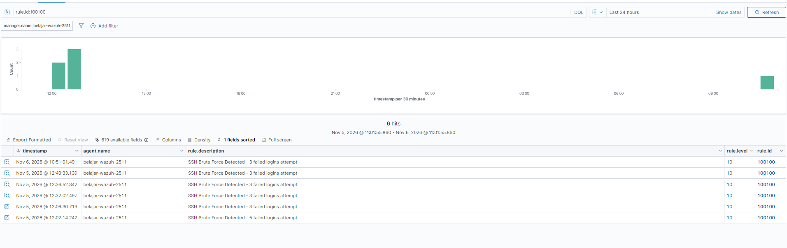
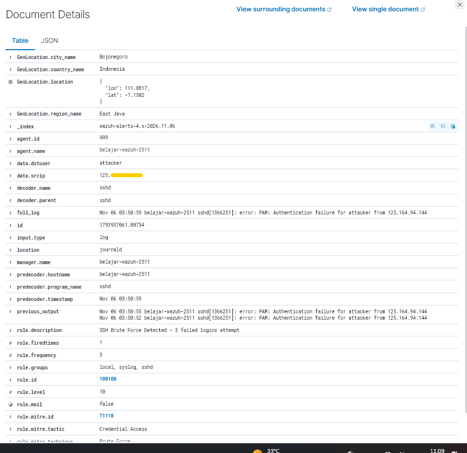
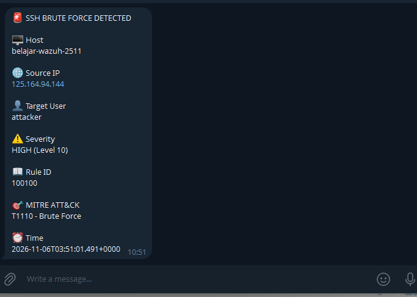

# Wazuh SOC Lab

## Overview

Personal SOC Lab project using Wazuh for detection engineering, threat hunting, and alert automation.

## Environment

- Ubuntu VPS
- Wazuh Manager
- Wazuh Dashboard
- Telegram Bot API

## Current Features

- SSH Failed Login Detection
- Custom SSH Brute Force Detection Rule
- MITRE ATT&CK Mapping (T1110)
- Telegram Alert Integration
- Linux VPS Monitoring

## Detection Workflow

```text
SSH Failed Login
        ↓
Rule 5716
        ↓
Rule 100100
        ↓
Telegram Integration
        ↓
Telegram Notification
```

## Custom Rule

```xml
<rule id="100100" level="10" frequency="3" timeframe="60">
    <if_matched_sid>5716</if_matched_sid>
    <description>
        SSH Brute Force Detected - 3 failed logins attempt
    </description>
    <mitre>
        <id>T1110</id>
    </mitre>
</rule>
```

## MITRE ATT&CK

- T1110 - Brute Force

## Telegram Alert Example

The project automatically sends Telegram notifications when the SSH brute-force detection rule is triggered.

## Future Improvements

- Active Response
- Automatic IP Blocking
- Cowrie Honeypot Integration
- AbuseIPDB Enrichment
- Sysmon Endpoint Monitoring

## Screenshots

### Rule Detection



Custom Wazuh rule (ID: 100100) triggered after 3 failed SSH login attempts within 60 seconds.

### Event Details



Detailed event information showing source IP, target user, MITRE mapping, rule level, and correlation frequency.

### Telegram Alert



Telegram notification automatically generated when the custom SSH brute-force detection rule is triggered.

## Author

Bagas Alif Utama
